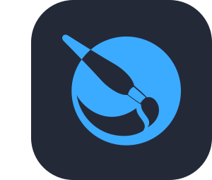

<h1 align="center">Hi, I'm Alexandre 👋</h1>

  

  
  
  

---

## 🧑‍💻 About Me

I'm a **Software Engineering graduate from UCB** (Catholic University of Brasília) with a background in **Graphic Design**. I love building software people actually enjoy using, from web and mobile apps to games, combining solid code with thoughtful visual design.

- 🟦 **Focus:** software development with **TypeScript** and **Python**, my two main languages, writing clean, maintainable code across the stack
- ☕ **Also working with:** **Java** for object-oriented and backend development
- 🎮 **Game dev:** building games and gameplay systems with **C++** and **C#**
- 🎨 **Design background:** graduated in **Graphic Design**, so I bring an eye for visual identity, layout, typography and user experience to games, software and websites
- 🏗️ **Experience:** building full-stack apps with React, Node/Express, Django and PostgreSQL, from architecture to delivery
- 🧠 **Curious about:** game design, player psychology and continuous learning
- 🤝 **Open to:** internships, junior developer roles and game jams

---

## 🛠️ Tech Stack

**Main Languages**

  

**Software Development**

  

**Game Development**

  

**Design, 3D & Creative**

  

**Backend, Data & Tools**

  

---

## 🚀 Featured Projects

| Project | Description | Stack |
|---|---|---|
| 📚 [**Livrin**](https://github.com/xandoqa/-editora-acessivel) | Full-stack accessible publishing platform with an in-browser EPUB/PDF reader and dyslexia-friendly fonts. Academic team project where I led development and technical decisions. |           |
| 🚗 [**CarroEmDia**](https://github.com/xandoqa/Carro_em_dia) | Mobile app for tracking car and motorcycle maintenance, with service history and upcoming services in one place. |    |
| 🧮 [**BeBetterAtMath**](https://github.com/xandoqa/BeBetterAtMath) | Gamified mental math trainer: multiplication tables and arithmetic drills to build calculation speed. |         |
| 🐋 [**BlueBell – Between the Two Worlds**](https://github.com/xandoqa/BlueBell_Between-the-worlds) | 🚧 *Game in development (pre-production).* Open-world isometric fantasy adventure based on my comic *BlueBell*: explore islands, study creatures in a field journal and travel between worlds on a flying whale. |        |

> 🎮 Currently building **BlueBell – Between the Two Worlds** in Godot + C#. More game projects coming soon.

---

## 📊 GitHub Stats

  
  

  

---

  <i>"Always looking for new challenges to improve my skills and build meaningful solutions."</i>  
  ⭐ Thanks for visiting! Feel free to reach out.

